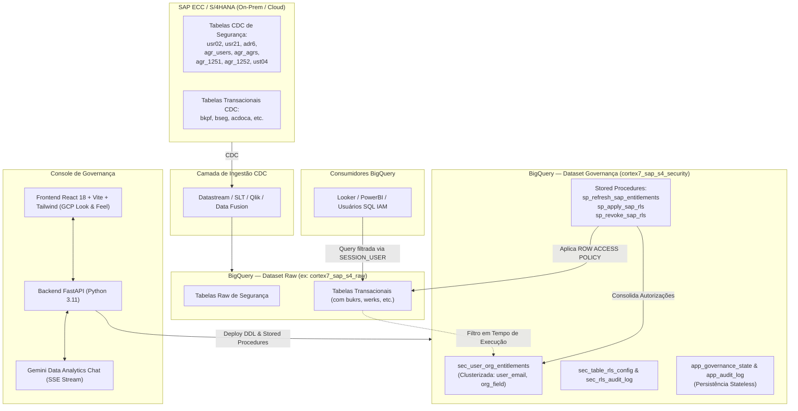

# SAP S/4HANA to Google Cloud BigQuery RLS Governance Console

Console unificado e automatizado para governança de acesso e transposição do modelo de segurança transacional do **SAP S/4HANA / ECC (PFCG)** para o **Google Cloud BigQuery** utilizando **Row-Level Security (RLS)** nativo (`ROW ACCESS POLICY`).

---

## 📌 Sumário

1. [Visão Geral & Contexto](#-visão-geral--contexto)
2. [Arquitetura da Solução](#-arquitetura-da-solução)
3. [Principais Funcionalidades](#-principais-funcionalidades)
4. [Estrutura do Projeto](#-estrutura-do-projeto)
5. [Tecnologias Utilizadas](#-tecnologias-utilizadas)
6. [Pré-requisitos](#-pré-requisitos)
7. [Como Executar Localmente](#-como-executar-localmente)
8. [Deploy no Google Cloud Run](#-deploy-no-google-cloud-run)
9. [Variáveis de Ambiente & Configuração](#-variáveis-de-ambiente--configuração)
10. [Modelo de Dados & Tabelas de Governança](#-modelo-de-dados--tabelas-de-governança)
11. [Controle de Acesso da Aplicação (RBAC) & Auditoria](#-controle-de-acesso-da-aplicação-rbac--auditoria)
12. [Documentação de Referência](#-documentação-de-referência)

---

## 🎯 Visão Geral & Contexto

Ao replicar dados transacionais do SAP (via CDC como Google Cloud Datastream, SAP SLT, Qlik Replicate ou Cloud Data Fusion) para o BigQuery, o maior desafio consiste na **governança de acesso granular**:

- **No SAP:** A segurança é transacional, baseada no framework **PFCG** (roles simples e compostas, objetos de autorização e níveis organizacionais como Empresa `bukrs`, Centro `werks`, Organização de Vendas `vkorg`, etc.).
- **No BigQuery:** O controle padrão do IAM é por projeto, dataset ou tabela. Para segregar linhas sem criar dezenas de views fragmentadas, é necessário aplicar **Row-Level Security (RLS)**.

Esta aplicação resolve esse desafio de ponta a ponta:
1. **Mapeamento de Identidade:** Cruza o usuário SAP (`bname`) com seu e-mail corporativo (`adr6` via `usr21`), conciliando com o `SESSION_USER()` do Google Cloud IAM.
2. **Resolução de Autorizações:** Desdobra permissões pontuais, faixas numéricas (`low` a `high`), coringas (`*`) e papéis estruturais (`SAP_ALL`) em uma tabela mestra otimizada e clusterizada (`sec_user_org_entitlements`).
3. **Automação por Metadados:** Escaneia o `INFORMATION_SCHEMA` para identificar tabelas transacionais contendo campos organizacionais (ex: `bukrs` em `bkpf`, `bseg`, `acdoca`) e aplica/revoga as políticas de RLS automaticamente via Stored Procedures.
4. **Simulação e Auditoria:** Permite testar permissões como qualquer usuário cadastrado (*Test as User*), audita toda e qualquer alteração de DDL e gerencia o estado da aplicação de forma persistente diretamente no BigQuery.

---

## 🏛 Arquitetura da Solução



---

## ⚡ Principais Funcionalidades

### 1. Conexões Multi-Ambiente & Autenticação GCP
- Suporte a múltiplos perfis de conexão (Produção, Homologação, Arquitetura de Referência).
- Modos de autenticação:
  - **Google Cloud ADC / OAuth:** Autenticação transparente com `gcloud auth application-default login`.
  - **OAuth 2.0 User Token:** Conexão vinculada ao token de usuário.
  - **Service Account (JSON Key):** Autenticação por chave de conta de serviço para pipelines automatizados.
- Diagnóstico automático com checagem de integridade das 8 tabelas de catálogo SAP e cálculo da taxa de cobertura de e-mails corporativos.

### 2. Setup Wizard Automatizado (Passo a Passo)
Pipeline guiado em 6 fases de provisionamento no BigQuery:
1. **Fase 0 (Diagnóstico):** Validação de pré-requisitos e volumetria das tabelas CDC SAP.
2. **Fase 1 (Schema):** Criação do dataset de governança no BigQuery.
3. **Fase 2 (DDL de Estruturas):** Criação das tabelas de *entitlements*, auditoria RLS e persistência de estado.
4. **Fase 3 (Stored Procedures):** Deploy das procedures SQL (`sp_refresh_sap_entitlements`, `sp_apply_sap_rls`, `sp_revoke_sap_rls`).
5. **Fase 4 (Consolidação):** Execução do cálculo de privilégios organizacionais e expansão de faixas/roles compostas.
6. **Fase 5 (Ativação RLS):** Aplicação de políticas `ROW ACCESS POLICY` por metadados em lote.
- Permite execução individual (com editor SQL em tempo real) ou execução em lote com 1 clique (*Executar Todos os Passos*).

### 3. Governança de Perfis, Matriz de Acesso e Matriz RLS
- **Catálogo de Roles SAP:** Consulta e visualização das roles PFCG mapeadas (`agr_users`, `agr_1251`, `agr_1252`), níveis organizacionais e contagem de usuários.
- **Matriz de Acesso (Entitlements):** Visão centralizada de acessos concedidos por usuário e grupo (ex: Google Workspace / Cloud Identity), suporte a concessões de grupos corporativos com sincronização imediata no BigQuery.
- **Matriz de Tabelas RLS:** Varredura dinâmica de tabelas com colunas organizacionais (ex: `bukrs`), indicando status de proteção (*PROTEGIDA* vs *DESPROTEGIDA*), número de linhas e ações pontuais ou em lote (`Apply All` / `Revoke All`).

### 4. Simulador de Acesso RLS (*"Test as User"*)
- Permite testar o comportamento do BigQuery simulando a identidade de qualquer usuário corporativo cadastrado.
- Executa queries reais sobre tabelas protegidas (ex: `bkpf`) e retorna os registros que o usuário visualizaria, bem como as empresas filtradas ou bloqueadas.

### 5. Assistente Inteligente (Gemini Data Analytics Chat)
- Chat com streaming de eventos SSE (`Server-Sent Events`) para suporte em linguagem natural sobre governança, permissões de usuários e tabelas protegidas.
- Integração com a API `google-cloud-geminidataanalytics` e fallback com execução de queries analíticas ao vivo no BigQuery.
- Exibição de raciocínio passo a passo (*Chain of Thought*) e sugestões dinâmicas de perguntas de acompanhamento.

### 6. Administração da Aplicação & RBAC Interno
- Gestão interna de operadores e perfis da aplicação:
  - `SUPER_ADMIN`: Acesso irrestrito a todas as operações.
  - `SECURITY_ADMIN`: Gestão de políticas, *entitlements* e simulação.
  - `DATA_ENGINEER`: Execução de setup, conexões e manutenção de schemas.
  - `AUDITOR`: Acesso somente-leitura com foco em auditoria e simulação.
- Matriz granular de permissões (`can_apply_rls`, `can_revoke_rls`, `can_run_setup`, `can_manage_entitlements`, `can_manage_app_users`).
- **Persistência Stateless no BigQuery:** Toda a configuração da aplicação é gravada na tabela `app_governance_state`, permitindo deploys no Cloud Run sem dependência de banco relacional externo.
- Trilha de auditoria completa em `app_audit_log`.

---

## 📂 Estrutura do Projeto

```text
.
├── backend/
│   ├── bq_service.py         # Motor de integração com BigQuery (DDL, Stored Procedures, RLS, Consultas)
│   ├── chat_service.py       # Integração com Gemini Data Analytics e fallback de chat analítico via SSE
│   ├── main.py               # Servidor FastAPI com rotas REST e montagem do SPA React
│   ├── state_store.py        # Gerenciador de estado local (JSON) com sincronização no BigQuery
│   └── data/                 # Armazenamento local do app_state.json (desenvolvimento)
├── frontend/
│   ├── src/
│   │   ├── components/       # Componentes reutilizáveis (ChatPanel, etc.)
│   │   ├── context/          # AppContext e estado global da interface
│   │   ├── pages/            # Telas principais:
│   │   │   ├── ConnectionsView.jsx    # Gerenciamento de conexões e diagnósticos
│   │   │   ├── SetupWizardView.jsx    # Wizard automatizado de provisionamento
│   │   │   ├── ProfilesView.jsx       # Catálogo de Roles, Matriz de Acesso e Matriz RLS
│   │   │   └── AppAdminView.jsx       # Gestão de usuários do console, RBAC e auditoria
│   │   ├── App.jsx           # Layout principal (GCP Console UI, navegação e tema claro/escuro)
│   │   └── main.jsx          # Ponto de entrada do React
│   ├── package.json          # Dependências do frontend (React, Vite, Tailwind, ECharts, etc.)
│   └── vite.config.js        # Configuração do Vite com proxy para a API
├── spec/
│   └── sdd-sap-authorization-bigquery.md # System Design Document (SDD) detalhado da arquitetura
├── Dockerfile                # Dockerfile multi-stage (Node.js build + Python 3.11 runtime)
├── deploy_cloud_run.sh       # Script automatizado de deploy no Google Cloud Run
├── start_app.sh              # Script de inicialização em ambiente local de desenvolvimento
└── requirements.txt          # Dependências Python do backend
```

---

## 🛠 Tecnologias Utilizadas

### Backend
- **Python 3.11**
- **FastAPI:** Framework web moderno de alta performance para APIs assíncronas.
- **Uvicorn:** Servidor ASGI para produção e desenvolvimento.
- **Google Cloud BigQuery Client Library (`google-cloud-bigquery`):** Execução de consultas, DDL e Stored Procedures com rotulagem de telemetria de jobs (`datacloud: antigravity`).
- **Google Cloud Gemini Data Analytics (`google-cloud-geminidataanalytics`):** Agente de IA para análise de dados e governança.
- **Google Auth (`google-auth`, `google-auth-oauthlib`):** Gestão de credenciais ADC, OAuth 2.0 e Service Accounts.

### Frontend
- **React 18 & Vite 5:** SPA rápida e modular com Hot Module Replacement (HMR).
- **Tailwind CSS:** Design system seguindo fielmente a identidade visual do **Google Cloud Console**.
- **Lucide React:** Conjunto completo de ícones modernos.
- **Apache ECharts (`echarts-for-react`):** Gráficos analíticos e telemetria.
- **React Markdown & Remark GFM:** Renderização formatada das respostas do assistente de IA.

### Infraestrutura & Dados
- **Google Cloud BigQuery:** Data Warehouse analítico, computação de Stored Procedures e enforcement de RLS.
- **Google Cloud Run:** Hospedagem gerenciada de contêineres sem servidor (*serverless*).
- **Google Cloud Build & Artifact Registry:** Pipeline de CI/CD para compilação da imagem Docker.

---

## 📋 Pré-requisitos

Para executar a aplicação localmente ou realizar deploy:

1. **Python:** Versão `3.11` ou superior instalada.
2. **Node.js:** Versão `20.x` ou superior (com `npm`).
3. **Google Cloud SDK (`gcloud` e `bq` CLI):** Instalado e autenticado.
4. **Permissões GCP:**
   - BigQuery Data Editor / BigQuery Admin no projeto alvo.
   - Cloud Run Admin e Service Usage Admin (para deploy).

---

## 🚀 Como Executar Localmente

### 1. Autenticar no Google Cloud
Configure suas credenciais de aplicação padrão (ADC):
```bash
gcloud auth login
gcloud auth application-default login
gcloud config set project ce-sap-latam-genai
```

### 2. Configurar o Ambiente Python (Backend)
```bash
# Na raiz do projeto:
python3 -m venv .venv
source .venv/bin/activate
pip install -r requirements.txt
```

### 3. Instalar Dependências do Frontend
```bash
cd frontend
npm install
cd ..
```

### 4. Iniciar a Aplicação Completa (Script Único)
O repositório inclui um script utilitário que inicia o FastAPI e o Vite em paralelo:
```bash
chmod +x start_app.sh
./start_app.sh
```

Acesse no navegador:
- **Frontend (Console):** `http://localhost:5173`
- **Backend API (Swagger Docs):** `http://localhost:8000/docs`

> *Caso prefira rodar em terminais separados:*
> - **Backend:** `.venv/bin/uvicorn main:app --app-dir backend --host 0.0.0.0 --port 8000 --reload`
> - **Frontend:** `cd frontend && npm run dev`

---

## ☁️ Deploy no Google Cloud Run

A aplicação conta com um script de implantação automatizado que:
1. Provisiona o dataset de governança e as tabelas de estado no BigQuery (`app_governance_state` e `app_audit_log`).
2. Habilita as APIs necessárias no projeto (`run`, `cloudbuild`, `artifactregistry`, `bigquery`, `geminidataanalytics`).
3. Compila a imagem Docker multi-stage via Cloud Build e implanta no Cloud Run.

### Executando o Deploy:
```bash
chmod +x deploy_cloud_run.sh
./deploy_cloud_run.sh
```

Você também pode customizar variáveis de ambiente inline:
```bash
BQ_PROJECT_ID="ce-sap-latam-genai" \
GCP_REGION="us-central1" \
SERVICE_NAME="sap-bq-rls-console" \
BQ_RAW_DATASET="cortex7_sap_s4_raw" \
BQ_GOVERNANCE_DATASET="cortex7_sap_s4_security" \
./deploy_cloud_run.sh
```

---

## ⚙️ Variáveis de Ambiente & Configuração

As seguintes variáveis de ambiente controlam o comportamento em runtime:

| Variável | Padrão | Descrição |
| :--- | :--- | :--- |
| `PORT` | `8080` (Cloud Run) / `8000` (Local) | Porta HTTP do servidor FastAPI. |
| `BQ_PROJECT_ID` | `ce-sap-latam-genai` | ID do projeto Google Cloud padrão. |
| `BQ_RAW_DATASET` | `cortex7_sap_s4_raw` | Dataset contendo as tabelas CDC brutas do SAP. |
| `BQ_GOVERNANCE_DATASET` | `cortex7_sap_s4_security` | Dataset de governança para tabelas mestras e procedures. |
| `BQ_LOCATION` | `US` | Região / localização do BigQuery. |
| `BQ_STATE_SYNC` | `true` | Habilita sincronização de estado com o BigQuery. |
| `BQ_BOOTSTRAP_ON_START` | `true` | Carrega o estado inicial do BigQuery ao subir o contêiner. |

---

## 🗄 Modelo de Dados & Tabelas de Governança

As tabelas gerenciadas pelo console no dataset de governança (`cortex7_sap_s4_security`) incluem:

### 1. `sec_user_org_entitlements`
Tabela mestra clusterizada (`user_email`, `org_field`) que armazena os privilégios organizacionais calculados:
- `user_email`: E-mail corporativo correspondente ao `SESSION_USER()`.
- `sap_uname`: Usuário no SAP (`bname`).
- `org_field`: Campo organizacional padronizado (`bukrs`, `werks`, `vkorg`, etc.).
- `org_value`: Valor pontual desnormalizado para correspondência direta no RLS.
- `val_low` e `val_high`: Faixa de autorização original do SAP.
- `is_all_access`: Indicador booleano de acesso total (`*` ou `SAP_ALL`).
- `source_roles`: Array de roles PFCG que originaram o privilégio.
- `updated_at`: Timestamp do processamento.

### 2. `sec_table_rls_config`
Configuração e rastreamento das tabelas protegidas por RLS:
- Identificação de tabela, coluna de filtro, status de ativação e *grantees* autorizados.

### 3. `sec_rls_audit_log`
Log de auditoria particionado por data de aplicação (`applied_at`) e clusterizado por tabela, registrando todas as operações de `APPLIED`, `REVOKED` e eventuais falhas.

### 4. `app_governance_state`
Armazenamento JSON da configuração do console (conexões, usuários e papéis da aplicação), permitindo arquitetura *stateless* no Cloud Run.

### 5. `app_audit_log`
Histórico de ações dos operadores no console (testes de conexão, alteração de perfis, execução de passos do wizard e simulações).

---

## 🔐 Controle de Acesso da Aplicação (RBAC) & Auditoria

O console implementa controle de acesso baseado em papéis (RBAC) com as seguintes permissões:

| Permissão | Descrição |
| :--- | :--- |
| `can_view_dashboard` | Visualizar métricas, conexões e catálogo de roles. |
| `can_run_setup` | Executar passos do Setup Wizard no BigQuery. |
| `can_apply_rls` | Aplicar políticas de Row-Level Security (`CREATE ROW ACCESS POLICY`). |
| `can_revoke_rls` | Revogar políticas de RLS (`DROP ROW ACCESS POLICY`). |
| `can_manage_entitlements` | Adicionar ou remover mapeamentos de grupos corporativos. |
| `can_simulate_access` | Executar o simulador de acesso (*Test as User*). |
| `can_manage_app_users` | Gerenciar operadores, papéis e configurações do console. |

O operador logado pode ser facilmente alternado na barra superior do console para verificação em tempo de execução das permissões concedidas.

---

## 📖 Documentação de Referência

Para detalhes aprofundados sobre a especificação técnica e design da solução, consulte:
- [System Design Document (SDD)](file:///Users/felipechagas/Repository/customers/spec/sdd-sap-authorization-bigquery.md): Especificação completa da transposição de autorizações SAP para BigQuery RLS.
- [Google Cloud BigQuery Row-Level Security Documentation](https://cloud.google.com/bigquery/docs/row-level-security-intro)
- [SAP Note 101052 - Authorization Check in Reporting](https://me.sap.com)

---

**Desenvolvido para Governança de Dados Corporativos — Google Cloud**
