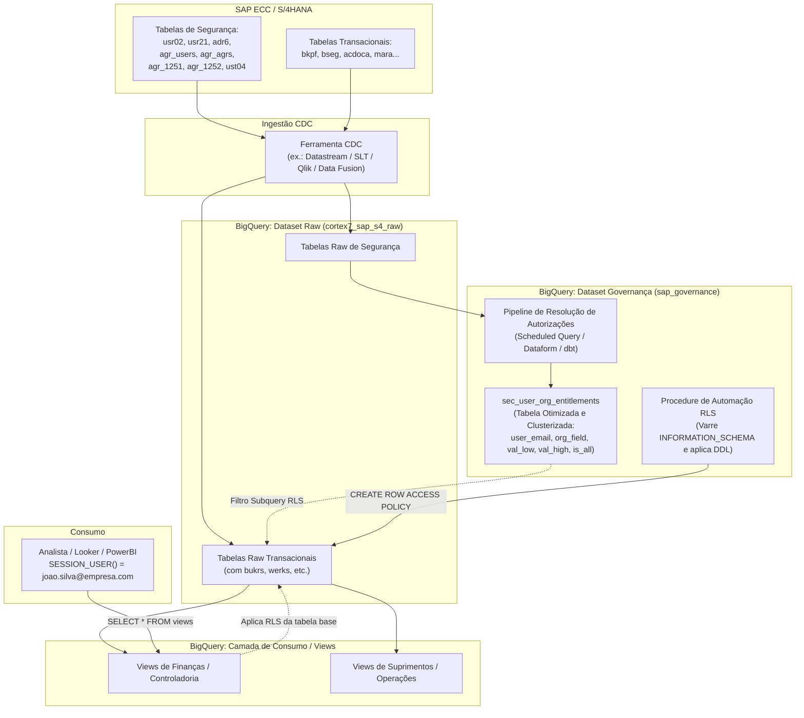

# System Design Document (SDD): Governança e Transposição de Autorizações SAP para Google Cloud BigQuery

**Projeto:** Governança de Acesso e Row-Level Security (RLS) SAP no BigQuery  
**Ambiente:** Google Cloud e SAP  
**Status:** Proposta Técnica / Arquitetura de Referência  
**Versão:** 1.0  
**Data:** 2026-09-24  

---

## 1. Visão Geral e Objetivos

### 1.1 Contexto
Todos os dados transacionais e cadastrais do SAP (ECC ou S/4HANA) estão sendo replicados de forma contínua (CDC - Change Data Capture) para o Google Cloud BigQuery. As visões analíticas de negócio são expostas aos usuários e sistemas por meio de camadas de views (camadas Raw, Conformed/Trusted e Serving/Analytics).

### 1.2 O Problema
O modelo de segurança do SAP é transacional, hierárquico e baseado no framework PFCG (Perfis, Roles Simples, Roles Compostas, Objetos de Autorização e Níveis Organizacionais). Em contrapartida, o BigQuery é um Data Warehouse analítico orientado a colunas, cujo modelo nativo de segurança se apoia no Google Cloud IAM (nível de projeto/dataset/tabela) e em recursos granulares como **Row-Level Security (RLS)** e **Column-Level Security (CLS)**.

Sem uma transposição automatizada das regras do SAP:
1. Haveria vazamento de dados corporativos restritos (ex.: usuário da empresa 1000 visualizando dados contábeis da empresa 2000).
2. A gestão manual de permissões no BigQuery seria inviável e dessincronizada da fonte primária (SAP).

### 1.3 Objetivos da Solução
- **Sincronização Contínua:** Replicar via CDC as tabelas do catálogo de segurança e autorizações do SAP.
- **Mapeamento Unívoco de Identidade:** Associar o usuário SAP (`bname`) à identidade Google autenticada no BigQuery (`SESSION_USER()`), utilizando o e-mail corporativo cadastrado no SAP.
- **Resolução de Níveis Organizacionais (Org Levels):** Tratar valores pontuais, intervalos (`low` e `high`), coringas (`*`) e herança de roles compostas.
- **Aplicação de Row-Level Security (RLS) de Alto Desempenho:** Garantir que o custo de computação e latência de queries analíticas sobre tabelas massivas (ex.: `bseg`, `acdoca`, `bkpf`) não sejam degradados.
- **Automação por Metadados:** Escanear o `INFORMATION_SCHEMA` para identificar tabelas com campos organizacionais (ex.: `bukrs`, `werks`, `vkorg`) e gerar/aplicar as políticas de RLS automaticamente.

---

## 2. Arquitetura da Solução

### 2.1 Diagrama de Arquitetura de Ponta a Ponta



---

## 3. Mapeamento do Modelo de Autorizações SAP (PFCG)

### 3.1 Dicionário das Tabelas SAP Necessárias

Para reconstruir as permissões do usuário em nível organizacional e associá-lo à identidade de nuvem, é mandatória a replicação das seguintes 8 tabelas:

| Tabela SAP | Nome Técnico / Descrição | Campos Críticos | Propósito no BigQuery |
| :--- | :--- | :--- | :--- |
| **`usr02`** | Dados de Logon do Usuário | `bname`, `gltgv`, `gltgb`, `uflag` | Validar se o usuário está ativo, não expirado e não bloqueado (`uflag = 0`). |
| **`usr21`** | Chave Mestra Usuário-Endereço | `bname`, `persnumber`, `addrnumber` | Ponte de relacionamento entre o usuário SAP e seus dados de comunicação. |
| **`adr6`** | Endereços de E-mail (Central Address Mgmt) | `addrnumber`, `persnumber`, `smtp_addr` | **Crítico:** Obtém o e-mail corporativo (`smtp_addr`), que faz o de-para direto com `SESSION_USER()`. |
| **`agr_users`** | Atribuição de Roles aos Usuários | `agr_name`, `uname`, `from_dat`, `to_dat` | Identifica quais roles PFCG estão atribuídas ao usuário e dentro do período de vigência. |
| **`agr_agrs`** | Estrutura de Roles Compostas | `agr_name`, `child_agr` | Desmembra roles compostas nas respectivas single roles filhas. |
| **`agr_1252`** | Níveis Organizacionais das Roles | `agr_name`, `varbl`, `low`, `high` | **Principal tabela de valores organizacionais:** guarda valores de `$bukrs`, `$werks`, `$vkorg`, etc. |
| **`agr_1251`** | Dados de Autorização / Objetos e Campos | `agr_name`, `object`, `field`, `low`, `high` | Captura campos que não foram promovidos a variáveis de nível org (ex.: objeto `f_bkpf_buk`, campo `bukrs`). |
| **`ust04`** | Perfis de Usuário Atribuídos Diretamente | `bname`, `profile` | **Mandatória para SAP_ALL:** Captura perfis gerados atribuídos diretamente ao usuário (SU01 -> Perfis), como `SAP_ALL` e `SAP_NEW`. |

> **Nota Técnica sobre Níveis Organizacionais ($varbl):**  
> No SAP PFCG, variáveis organizacionais iniciam com cifrão (ex.: `$bukrs` para Empresa, `$werks` para Centro). A convenção de De-Para no BigQuery remove o prefixo `$` para casar diretamente com a coluna homônima da tabela (`bukrs`, `werks`).

### 3.2 Como o BigQuery Trata o Usuário com `SAP_ALL` (Superusuário)?

No SAP, `SAP_ALL` **não é uma Role PFCG (`agr_*`)**, mas sim um **Perfil Composto Gerado** que contém todos os objetos de autorização com todos os campos coringados (`*`). Ele pode ser atribuído a um usuário de duas formas:
1. **Atribuição Direta de Perfil na SU01:** Fica registrado exclusivamente na tabela **`ust04`** (`profile = 'SAP_ALL'`), sem registro em `agr_users`.
2. **Atribuição via Role PFCG:** Uma role contendo o perfil gerado ou todos os objetos com `*`.

#### Arquitetura de Tratamento no BigQuery:
Para que o usuário com `SAP_ALL` tenha acesso total instantâneo sem perda de desempenho, adotamos uma estratégia em três camadas:

1. **Captura na Ingestão CDC:** A tabela `ust04` é replicada para identificar qualquer usuário com `UPPER(profile) IN ('SAP_ALL', 'SAP_NEW')`.
2. **Flag de Acesso Global na Tabela de Entitlements (`sec_user_org_entitlements`):**
   - O pipeline insere um registro para o usuário com `org_field = '*'` e `is_all_access = TRUE`.
   - Na política de RLS, a cláusula avalia `(ent.org_field = 'bukrs' OR ent.org_field = '*') AND ent.is_all_access = TRUE`. Se verdadeiro, o usuário visualiza 100% das linhas de qualquer empresa, centro ou organização de vendas.
3. **Curto-Circuito de Performance (Short-Circuit Evaluation):**
   - Para evitar que superusuários precisem avaliar predicados por linha, o pipeline também alimenta uma tabela leve de bypass: `sec_superusers`.
   - Na política de RLS, essa verificação ocorre no topo do predicado (`SESSION_USER() IN (SELECT user_email FROM sec_superusers)`). Se o usuário estiver na lista, o BigQuery pula qualquer join ou subquery e executa a query em velocidade máxima nativa.
4. **Auditoria e Compliance SOX:**
   - Atribuições de `SAP_ALL` são exceções de alto risco de segurança. O pipeline cria a view de auditoria `vw_audit_sap_all_users` e gera alertas na tabela de auditoria `sec_rls_audit_log` para acompanhamento do time de Governança corporativa.

### 3.3 Outros Casos Especiais no Modelo SAP e Estratégia de Resolução

1. **Validade e Bloqueio de Usuários:**
   - Um usuário só terá autorizações ativas se `usr02.uflag = 0` (não bloqueado) e `CURRENT_DATE() BETWEEN usr02.gltgv AND usr02.gltgb`.
   - A atribuição da role deve estar vigente: `CURRENT_DATE() BETWEEN agr_users.from_dat AND agr_users.to_dat`.

2. **Herança de Roles Compostas (`agr_agrs`):**
   - Se o usuário receber a role composta `comp_fin_br`, a tabela `agr_agrs` expande essa role para as single roles `role_fi_1000`, `role_fi_2000`. O pipeline resolve essa relação com um `UNION ALL` entre roles diretas e roles filhas.

3. **Coringas / Acesso Total por Campo (`low = '*'`):**
   - Quando `low = '*'` na `agr_1252` para um nível específico (ex.: `$bukrs`), o usuário tem acesso total àquele campo específico (`org_field = 'bukrs'`, `is_all_access = TRUE`).

4. **Intervalos (`BETWEEN low AND high`):**
   - No SAP, faixas de códigos (ex.: `1000` a `1050`) são tratadas preservando `val_low` e `val_high` e aplicando a cláusula `BETWEEN` na condição da política de RLS.

5. **Cumulatividade (Modelo Aditivo):**
   - Permissões no SAP são sempre cumulativas. Se uma role concede `bukrs = 1000` e outra concede `bukrs = 2000`, o usuário tem acesso a ambas.

---

## 4. Modelagem de Dados de Governança no BigQuery

### 4.1 Estrutura da Tabela Otimizada de Entitlements

Para evitar joins caros entre as tabelas `agr_*` durante cada query analítica de usuário, criamos uma tabela desnormalizada, materializada e clusterizada chamada `sec_user_org_entitlements`.

```sql
CREATE OR REPLACE TABLE `gcp-data-lake.sap_governance.sec_user_org_entitlements`
(
  user_email STRING NOT NULL OPTIONS(description="E-mail corporativo (SESSION_USER() em lowercase)"),
  sap_uname STRING NOT NULL OPTIONS(description="ID do usuário no SAP (bname)"),
  org_field STRING NOT NULL OPTIONS(description="Nome do campo organizacional correspondente no BQ (ex.: bukrs, werks)"),
  org_value STRING OPTIONS(description="Valor organizacional desnormalizado para correspondência direta no RLS (IN subquery)"),
  val_low STRING OPTIONS(description="Valor pontual ou limite inferior do intervalo"),
  val_high STRING OPTIONS(description="Limite superior do intervalo (NULL se valor pontual)"),
  is_all_access BOOL NOT NULL OPTIONS(description="Flag indicando se o usuário possui acesso coringa (*) para este campo"),
  source_roles ARRAY<STRING> OPTIONS(description="Lista de roles que originaram esta concessão (rastreabilidade e auditoria)"),
  updated_at TIMESTAMP NOT NULL OPTIONS(description="Data da última consolidação da permissão")
)
CLUSTER BY user_email, org_field;
```

### 4.2 Pipeline SQL de De-Para e Consolidação (Incremental ou Agendado)

Esta query compõe o job (via BigQuery Scheduled Query, Dataform ou dbt) que roda periodicamente ou disparado por alterações nas tabelas de segurança do SAP.

```sql
WITH active_users AS (
  -- 1. Filtra usuários ativos, válidos e com e-mail corporativo válido
  SELECT
    LOWER(TRIM(a.smtp_addr)) AS user_email,
    u.bname AS sap_uname
  FROM `ce-sap-latam-genai.cortex7_sap_s4_raw.usr02` u
  INNER JOIN `ce-sap-latam-genai.cortex7_sap_s4_raw.usr21` up
    ON u.bname = up.bname
  INNER JOIN `ce-sap-latam-genai.cortex7_sap_s4_raw.adr6` a
    ON up.persnumber = a.persnumber AND up.addrnumber = a.addrnumber
  WHERE (u.uflag IS NULL OR u.uflag = 0)
    AND CURRENT_DATE() BETWEEN COALESCE(u.gltgv, DATE '1900-01-01') AND COALESCE(u.gltgb, DATE '9999-12-31')
    AND a.smtp_addr IS NOT NULL
    AND a.smtp_addr LIKE '%@%'
),

user_roles_expanded AS (
  -- 2. Resolve roles simples e roles compostas (agr_agrs)
  SELECT
    au.user_email,
    au.sap_uname,
    COALESCE(comp.child_agr, r.agr_name) AS effective_role
  FROM active_users au
  INNER JOIN `ce-sap-latam-genai.cortex7_sap_s4_raw.agr_users` r
    ON au.sap_uname = r.uname
  LEFT JOIN `ce-sap-latam-genai.cortex7_sap_s4_raw.agr_agrs` comp
    ON r.agr_name = comp.agr_name
  WHERE CURRENT_DATE() BETWEEN COALESCE(r.from_dat, DATE '1900-01-01') AND COALESCE(r.to_dat, DATE '9999-12-31')
),

org_permissions AS (
  -- 3A. Permissões originadas na agr_1252 (Níveis Organizacionais com prefixo $)
  SELECT
    ur.user_email,
    ur.sap_uname,
    ur.effective_role,
    LOWER(REGEXP_REPLACE(a1252.varbl, r'^\$', '')) AS org_field,
    TRIM(a1252.low) AS val_low,
    TRIM(a1252.high) AS val_high
  FROM user_roles_expanded ur
  INNER JOIN `ce-sap-latam-genai.cortex7_sap_s4_raw.agr_1252` a1252
    ON ur.effective_role = a1252.agr_name
  WHERE a1252.varbl IS NOT NULL

  UNION ALL

  -- 3B. Permissões originadas na agr_1251 (Campos de autorização explícitos)
  SELECT
    ur.user_email,
    ur.sap_uname,
    ur.effective_role,
    LOWER(TRIM(a1251.field)) AS org_field,
    TRIM(a1251.low) AS val_low,
    TRIM(a1251.high) AS val_high
  FROM user_roles_expanded ur
  INNER JOIN `ce-sap-latam-genai.cortex7_sap_s4_raw.agr_1251` a1251
    ON ur.effective_role = a1251.agr_name
  WHERE LOWER(a1251.field) IN ('bukrs', 'werks', 'vkorg', 'ekorg', 'gsber', 'prctr')

  UNION ALL

  -- 3C. Superusuários com Perfil Direto SAP_ALL (ust04)
  SELECT
    au.user_email,
    au.sap_uname,
    'PROFILE:SAP_ALL' AS effective_role,
    '*' AS org_field,
    '*' AS val_low,
    CAST(NULL AS STRING) AS val_high
  FROM active_users au
  INNER JOIN `ce-sap-latam-genai.cortex7_sap_s4_raw.ust04` p
    ON au.sap_uname = p.bname
  WHERE UPPER(p.profile) IN ('SAP_ALL', 'SAP_NEW')
),

master_bukrs AS (
  SELECT DISTINCT bukrs AS org_value FROM `ce-sap-latam-genai.cortex7_sap_s4_raw.t001`
  UNION DISTINCT
  SELECT DISTINCT bukrs FROM `ce-sap-latam-genai.cortex7_sap_s4_raw.bkpf`
),

expanded_values AS (
  -- 1. Valores pontuais simples
  SELECT
    p.user_email,
    p.sap_uname,
    p.org_field,
    p.val_low AS org_value,
    p.val_low,
    p.val_high,
    FALSE AS is_all_access,
    p.effective_role
  FROM org_permissions p
  WHERE p.val_low != '*' 
    AND (p.val_high IS NULL OR p.val_high = '')

  UNION ALL

  -- 2. Faixas de valores (val_low até val_high) expandidas contra a tabela mestre de empresas
  SELECT
    p.user_email,
    p.sap_uname,
    p.org_field,
    m.org_value,
    p.val_low,
    p.val_high,
    FALSE AS is_all_access,
    p.effective_role
  FROM org_permissions p
  JOIN master_bukrs m
    ON p.org_field = 'bukrs' AND m.org_value BETWEEN p.val_low AND p.val_high
  WHERE p.val_high IS NOT NULL AND p.val_high != ''

  UNION ALL

  -- 3. Acesso Total (*) e Superusuários (SAP_ALL)
  SELECT
    p.user_email,
    p.sap_uname,
    p.org_field,
    CAST(NULL AS STRING) AS org_value,
    p.val_low,
    p.val_high,
    TRUE AS is_all_access,
    p.effective_role
  FROM org_permissions p
  WHERE p.val_low = '*' OR p.org_field = '*'
)

-- 4. Consolidação final por usuário, campo organizacional e valores desnormalizados
SELECT
  user_email,
  sap_uname,
  org_field,
  org_value,
  val_low,
  val_high,
  is_all_access,
  ARRAY_AGG(DISTINCT effective_role) AS source_roles,
  CURRENT_TIMESTAMP() AS updated_at
FROM expanded_values
WHERE (org_value IS NOT NULL AND org_value != '') OR is_all_access = TRUE
GROUP BY user_email, sap_uname, org_field, org_value, val_low, val_high, is_all_access;
```

---

## 5. Implementação de Row-Level Security (RLS) no BigQuery

### 5.1 Regra de Aplicação: Onde aplicar o RLS? (Raw vs Views)

#### Comportamento das Views no BigQuery:
1. **Views Padrão (`SECURITY INVOKER`):** Quando um usuário consulta uma view que aponta para uma tabela raw protegida por RLS, o BigQuery avalia o RLS **com o contexto do usuário chamador** (`SESSION_USER()`). Portanto, **aplicar RLS nas tabelas RAW garante a proteção em todas as views downstream**, além de proteger contra consultas acidentais diretamente nas tabelas brutas.
2. **Authorized Views (`SECURITY DEFINER`):** Se as views forem autorizadas para permitir que usuários sem acesso ao dataset raw as consultem, o RLS das tabelas base só é herdado se a view não encapsular a tabela em outro contexto. A melhor prática do Google Cloud é manter o RLS nas tabelas primárias ou aplicar políticas equivalentes nas tabelas materializadas/views de consumo.

### 5.2 Sintaxe e Otimização do DDL da Política RLS

Para evitar que a subquery degrade a performance em tabelas com bilhões de registros (ex.: `bseg` ou `acdoca`), a consulta à tabela de autorizações deve ser estruturada com **predicado indexável / pushdown** e suporte automático a `SAP_ALL`:

```sql
CREATE OR REPLACE ROW ACCESS POLICY rap_sap_bukrs
ON `ce-sap-latam-genai.cortex7_sap_s4_raw.bkpf`
GRANT TO (
  'group:gcp-bi-analysts@empresa.com',
  'group:gcp-sap-consumers@empresa.com'
)
FILTER USING (
  -- Grupo 1: Contas de serviço, administradores e pipelines de dados (Bypass total)
  SESSION_USER() LIKE '%@gcp-data-lake.iam.gserviceaccount.com'
  OR SESSION_USER() IN ('admin-governance@empresa.com')

  -- Grupo 2: Superusuários com Acesso Total (*) ou SAP_ALL (Top-Level IN subquery não correlacionada)
  OR TRUE IN (
    SELECT is_all_access
    FROM `gcp-data-lake.sap_governance.sec_user_org_entitlements`
    WHERE user_email = SESSION_USER()
      AND (org_field = 'bukrs' OR org_field = '*')
      AND is_all_access = TRUE
  )

  -- Grupo 3: Usuários com escopo organizacional específico (Top-Level IN subquery não correlacionada)
  OR bukrs IN (
    SELECT org_value
    FROM `gcp-data-lake.sap_governance.sec_user_org_entitlements`
    WHERE user_email = SESSION_USER()
      AND org_field = 'bukrs'
  )
);
```

> **Por que este formato é otimizado?**
> 1. A tabela `sec_user_org_entitlements` é clusterizada por `user_email` e `org_field`. O BigQuery lê apenas alguns kilobytes para recuperar as regras daquele usuário específico.
> 2. O otimizador de consultas avalia o bypass de Service Accounts e Superusuários primeiro, evitando overhead analítico.
> 3. Utiliza **Top-Level IN subqueries não correlacionadas**, em conformidade estrita com as especificações do BigQuery (evitando erros de subquery correlacionada envolvendo a tabela de destino).
> 4. Permite que o BigQuery aplique **Block Pruning** nativo no clustering da coluna alvo (`bukrs`), lendo apenas os blocos de dados físicos pertinentes ao usuário.

---

## 6. Automação por Metadados (Metadata-Driven RLS)

Em vez de criar scripts manuais para centenas de tabelas do SAP, utilizamos uma Stored Procedure que inspeciona o `INFORMATION_SCHEMA.COLUMNS` do BigQuery, identifica todas as tabelas que contêm o campo organizacional (ex.: `bukrs`) e gera/aplica as políticas de RLS dinamicamente.

### 6.1 Stored Procedure de Aplicação Automática

```sql
CREATE OR REPLACE PROCEDURE `gcp-data-lake.sap_governance.sp_apply_sap_rls`(
  target_project STRING,
  target_dataset STRING,
  org_column_name STRING,
  target_consumer_groups STRING
)
BEGIN
  DECLARE sql_query STRING;
  DECLARE formatted_grantees STRING;
  DECLARE dynamic_grantees STRING;
  SET formatted_grantees = TRIM(COALESCE(target_consumer_groups, ''));

  -- Modo Dinâmico: Se nenhum grantee for passado, extrai da tabela de entitlements
  IF formatted_grantees = '' OR formatted_grantees = "''" OR formatted_grantees = '""' THEN
    EXECUTE IMMEDIATE FORMAT("""
      SELECT STRING_AGG(DISTINCT CONCAT("'user:", LOWER(user_email), "'"), ', ')
      FROM `%s.sap_governance.sec_user_org_entitlements`
      WHERE (LOWER(org_field) = LOWER('%s') OR org_field = '*')
        AND user_email IS NOT NULL AND user_email != ''
    """, target_project, org_column_name)
    INTO dynamic_grantees;

    IF dynamic_grantees IS NOT NULL AND dynamic_grantees != '' THEN
      SET formatted_grantees = dynamic_grantees;
    ELSE
      SET formatted_grantees = "'user:admin-governanca@empresa.com'";
    END IF;
  ELSE
    -- Garante que os membros IAM possuam aspas simples se forem passados como string direta
    IF NOT (STARTS_WITH(formatted_grantees, "'") OR STARTS_WITH(formatted_grantees, '"')) THEN
      SET formatted_grantees = FORMAT("'%s'", formatted_grantees);
    END IF;
  END IF;

  -- Cursor temporário com as tabelas do dataset que possuem a coluna informada
  FOR target IN (
    SELECT table_name
    FROM `ce-sap-latam-genai.cortex7_sap_s4_raw.INFORMATION_SCHEMA.COLUMNS`
    WHERE LOWER(column_name) = LOWER(org_column_name)
      -- Não aplicar em tabelas de auditoria interna ou de segurança
      AND table_name NOT LIKE 'agr_%'
      AND table_name NOT LIKE 'usr%'
      AND table_name NOT LIKE 'adr%'
      AND table_name NOT LIKE 'dd%'
      AND table_name NOT LIKE 't001%'
      AND table_name NOT LIKE 'sec_%'
    GROUP BY table_name
  )
  DO
    -- Monta o comando dinâmico DDL de criação da política de RLS com subqueries não correlacionadas
    SET sql_query = FORMAT("""
      CREATE OR REPLACE ROW ACCESS POLICY rap_auto_%s_%s
      ON `%s.%s.%s`
      GRANT TO (%s)
      FILTER USING (
        SESSION_USER() LIKE '%%@gcp-data-lake.iam.gserviceaccount.com'
        OR SESSION_USER() IN ('admin-governanca@empresa.com')
        OR TRUE IN (
          SELECT is_all_access
          FROM `gcp-data-lake.sap_governance.sec_user_org_entitlements`
          WHERE user_email = SESSION_USER()
            AND (org_field = '%s' OR org_field = '*')
            AND is_all_access = TRUE
        )
        OR %s IN (
          SELECT org_value
          FROM `gcp-data-lake.sap_governance.sec_user_org_entitlements`
          WHERE user_email = SESSION_USER()
            AND org_field = '%s'
        )
      );
    """, 
      LOWER(org_column_name), 
      LOWER(target.table_name),
      target_project, 
      target_dataset, 
      target.table_name,
      formatted_grantees,
      LOWER(org_column_name), 
      LOWER(org_column_name), 
      LOWER(org_column_name)
    );

    -- Executa a DDL
    EXECUTE IMMEDIATE sql_query;
  END FOR;
END;
```

#### Exemplo de Chamada:
```sql
CALL `gcp-data-lake.sap_governance.sp_apply_sap_rls`(
  'ce-sap-latam-genai', 
  'cortex7_sap_s4_raw', 
  'bukrs', 
  "'group:gcp-bi-analysts@empresa.com', 'group:gcp-sap-consumers@empresa.com'"
);
```

### 6.4 Stored Procedure de Remoção Emergencial e Rollback (`sp_revoke_sap_rls`)
Permite reverter em lote as políticas de segurança aplicadas no dataset.

> **Regra de Segurança do BigQuery (DROP ALL):** Ao remover a **última ou única** política de uma tabela, o BigQuery impede `DROP ROW ACCESS POLICY <nome>` com o erro:
> `Dropping the last row access policy would make the table accessible to all users who have access to the table. If this is intended, please use a DROP ALL statement instead.`
> A procedure realiza a tentativa inicial de DROP da política daquele nível organizacional e, caso receba a indicação de última política, executa de forma segura `DROP ALL ROW ACCESS POLICIES` na tabela, registrando os passos em `sec_rls_audit_log`.

```sql
CREATE OR REPLACE PROCEDURE `gcp-data-lake.sap_governance.sp_revoke_sap_rls`(
  target_project STRING,
  target_dataset STRING,
  org_column_name STRING
)
BEGIN
  DECLARE exec_id STRING;
  SET exec_id = GENERATE_UUID();

  FOR target IN (
    SELECT DISTINCT table_name
    FROM `ce-sap-latam-genai.cortex7_sap_s4_raw.INFORMATION_SCHEMA.COLUMNS`
    WHERE LOWER(column_name) = LOWER(org_column_name)
      AND table_schema = target_dataset
      AND table_name NOT LIKE 'agr_%'
      AND table_name NOT LIKE 'usr%'
      AND table_name NOT LIKE 'adr%'
      AND table_name NOT LIKE 'dd%'
      AND table_name NOT LIKE 't001%'
      AND table_name NOT LIKE 'sec_%'
    UNION DISTINCT
    SELECT DISTINCT target_table AS table_name
    FROM `gcp-data-lake.sap_governance.sec_rls_audit_log`
    WHERE target_project = target_project
      AND target_dataset = target_dataset
      AND LOWER(org_field) = LOWER(org_column_name)
      AND action = 'APPLIED'
  )
  DO
    BEGIN
      DECLARE policy_name STRING;
      SET policy_name = FORMAT('rap_auto_%s_%s', LOWER(org_column_name), LOWER(target.table_name));

      BEGIN
        EXECUTE IMMEDIATE FORMAT("""
          DROP ROW ACCESS POLICY IF EXISTS %s ON `%s.%s.%s`;
        """, policy_name, target_project, target_dataset, target.table_name);

        INSERT INTO `gcp-data-lake.sap_governance.sec_rls_audit_log`
        VALUES (
          exec_id, target_project, target_dataset, target.table_name, LOWER(org_column_name),
          'REVOKED', policy_name, NULL, SESSION_USER(), CURRENT_TIMESTAMP()
        );
      EXCEPTION WHEN ERROR THEN
        IF CONTAINS_SUBSTR(LOWER(@@error.message), 'drop all') 
           OR CONTAINS_SUBSTR(LOWER(@@error.message), 'last row access policy') THEN
          BEGIN
            EXECUTE IMMEDIATE FORMAT("""
              DROP ALL ROW ACCESS POLICIES ON `%s.%s.%s`;
            """, target_project, target_dataset, target.table_name);

            INSERT INTO `gcp-data-lake.sap_governance.sec_rls_audit_log`
            VALUES (
              exec_id, target_project, target_dataset, target.table_name, LOWER(org_column_name),
              'REVOKED', FORMAT('%s (DROP ALL)', policy_name), NULL, SESSION_USER(), CURRENT_TIMESTAMP()
            );
          EXCEPTION WHEN ERROR THEN
            INSERT INTO `gcp-data-lake.sap_governance.sec_rls_audit_log`
            VALUES (
              exec_id, target_project, target_dataset, target.table_name, LOWER(org_column_name),
              'FAILED_REVOKE', policy_name, @@error.message, SESSION_USER(), CURRENT_TIMESTAMP()
            );
          END;
        ELSE
          INSERT INTO `gcp-data-lake.sap_governance.sec_rls_audit_log`
          VALUES (
            exec_id, target_project, target_dataset, target.table_name, LOWER(org_column_name),
            'FAILED_REVOKE', policy_name, @@error.message, SESSION_USER(), CURRENT_TIMESTAMP()
          );
        END IF;
      END;
    END;
  END FOR;
END;
```

---

## 7. Performance, FinOps e Boas Práticas

### 7.1 Impacto em Tabelas Grandes (`acdoca`, `bseg`, `mseg`)
Tabelas financeiras e de materiais no SAP acumulam facilmente centenas de milhões ou bilhões de linhas.
- **Clustering Físico Obrigatório:** Todas as tabelas transacionais que recebem RLS por `bukrs` **devem ter `bukrs` como primeira ou segunda coluna de clustering** no BigQuery:
  ```sql
  -- Exemplo para tabela financeira
  CLUSTER BY bukrs, gjahr, belnr;
  ```
- O BigQuery utiliza os metadados de clustering para podar blocos de dados (block pruning) antes mesmo de ler os registros em disco, mitigando o custo de varredura.

### 7.2 Cache de Consultas
- Consultas protegidas por Row-Level Security **não utilizam o cache de resultados global**, mas podem se beneficiar do cache por usuário se a query idêntica for repetida pelo mesmo `SESSION_USER()`.
- A separação de Service Accounts com bypass garante que relatórios automatizados de fechamento de dados rodem na velocidade nativa do BigQuery.

### 7.3 Multi-Nível Org (Exemplo: bukrs + werks)
Quando uma tabela possui tanto `bukrs` (Empresa) quanto `werks` (Centro), pode-se optar por:
1. **Duas políticas independentes:** No BigQuery, quando uma tabela tem mais de uma política de RLS aplicada a um usuário, elas são combinadas com **OR** se forem políticas concedidas separadamente, a menos que sejam estruturadas na mesma expressão de predicado.
2. **Política Combinada (Recomendado):** Uma única política que valida tanto `bukrs` quanto `werks`, utilizando regras de compatibilidade entre os dois níveis organizacionais.

---

## 8. Governança, Auditoria e Validação

### 8.1 Monitoramento de Políticas Ativas
É possível auditar a qualquer momento todas as políticas ativas no BigQuery consultando o histórico de auditoria da governança (`sec_rls_audit_log`):
```sql
SELECT 
  target_project,
  target_dataset,
  target_table,
  org_field,
  policy_name,
  action,
  applied_by,
  applied_at
FROM `ce-sap-latam-genai.cortex7_sap_s4_security.sec_rls_audit_log`
WHERE action IN ('APPLIED', 'REVOKED')
QUALIFY ROW_NUMBER() OVER (PARTITION BY target_table, org_field ORDER BY applied_at DESC) = 1
ORDER BY target_table;
```

### 8.2 Matriz de Casos de Teste (Quality Assurance)

| Cenário de Teste | Dados de Entrada no SAP | Resultado Esperado no BigQuery |
| :--- | :--- | :--- |
| **1. Usuário com 1 Empresa** | João: Role com `bukrs = '1000'` | João executa `SELECT DISTINCT bukrs FROM bkpf` e vê **apenas 1000**. |
| **2. Usuário com Múltiplas Roles** | Maria: Role A (`1000`), Role B (`2000`) | Maria visualiza dados de **1000 e 2000**. |
| **3. Usuário com Range** | Carlos: Role com `1000` a `1050` | Carlos visualiza empresas **1000, 1010, 1020, 1050**, mas não 2000. |
| **4. Usuário com Coringa (*)** | Gestor: Role com `bukrs = *` | Gestor visualiza **todas as empresas** existentes na tabela. |
| **5. Usuário Bloqueado/Expirado** | Ana: `usr02.uflag = 128` ou `gltgb < HOJE` | Tabela de entitlements não gera registros para Ana; ela não enxerga nenhuma linha. |
| **6. Usuário sem E-mail no SAP** | Conta técnica SAP sem `adr6` | Alerta emitido pelo pipeline de consolidação para ajuste cadastral. |
| **7. Service Account de Ingestão** | Pipeline `sa-dataproc@...` | Bypassa RLS e lê/escreve a totalidade da tabela sem restrições. |

---

## 9. Plano de Ação para Implementação

### Cronograma Técnico de Execução (7 Semanas)

| Fase | Período | Entregáveis & Marcos Críticos | Responsáveis | Critério de Sucesso (DoD) |
| :--- | :--- | :--- | :--- | :--- |
| **Fase 1: Fundação & Identidade** | 01/10 a 14/10 *(12 dias)* | • Replicação CDC das 8 tabelas de segurança (`usr*`, `agr*`, `adr*`, `ust*`)<br>• Homologação do vínculo `bname` &rarr; `persnumber` &rarr; `smtp_addr` | Engenharia de Dados & Basis SAP | Cobertura de e-mails corporativos &ge; 95% |
| **Fase 2: Modelagem & Entitlements** | 15/10 a 28/10 *(11 dias)* | • Criação da tabela clusterizada `sec_user_org_entitlements`<br>• Resolução de roles compostas (`agr_agrs`), coringas (`*`) e intervalos | Engenharia de Dados & Governança | Carga diária executada em &lt; 3 minutos |
| **Fase 3: RLS & Automação** | 29/10 a 11/11 *(13 dias)* | • Criação da Stored Procedure dinâmica `sp_apply_sap_rls`<br>• Piloto em Finanças (`bkpf`, `bseg`) com validação de *Block Pruning* | BigQuery & Finanças Corporativo | Latência de consulta via View sem degradação |
| **Fase 4: Validação & Rollout** | 12/11 a 24/11 *(10 dias)* | • Homologação cruzada com auditoria de Segurança SAP<br>• Rollout massivo para Suprimentos (MM) e Vendas (SD)<br>• Ativação de Runbook operacional | Governança de TI & Auditoria | Zero vazamento de dados entre empresas |

1. **Sprint 1 (Fundação de Dados de Segurança):**
   - Confirmar a ingestão CDC sem atrasos das tabelas: `usr02`, `usr21`, `adr6`, `agr_users`, `agr_agrs`, `agr_1251`, `agr_1252`, `ust04`.
   - Ajustar rotina para identificar usuários SAP cujo e-mail corporativo não coincida com o domínio Google Workspace/Cloud Identity.
2. **Sprint 2 (Pipeline de Entitlements):**
   - Criar o dataset `sap_governance` e a tabela `sec_user_org_entitlements`.
   - Agendar o pipeline de carga (ex.: a cada 1 hora ou disparado por eventos CDC de segurança).
3. **Sprint 3 (PoC de RLS e Validação de Performance):**
   - Aplicar política manual na `bkpf` e validar tempo de resposta em consultas no Looker / Power BI.
   - Ajustar particionamento e clustering de `bukrs`.
4. **Sprint 4 (Automação Global):**
   - Executar a Stored Procedure em todas as tabelas raw que possuem campos organizacionais e abrir o acesso às views de consumo.
